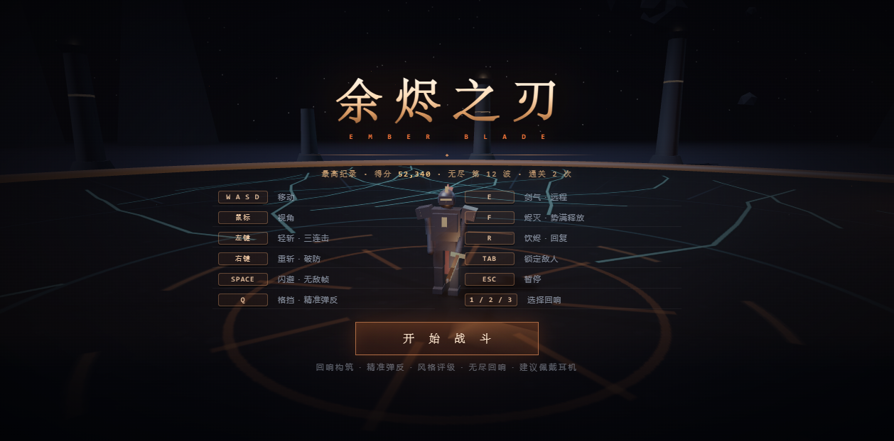
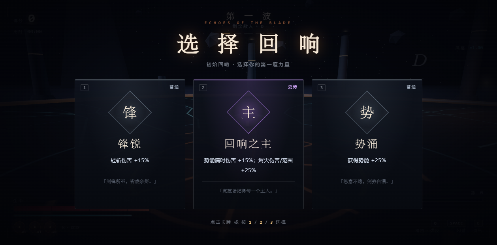
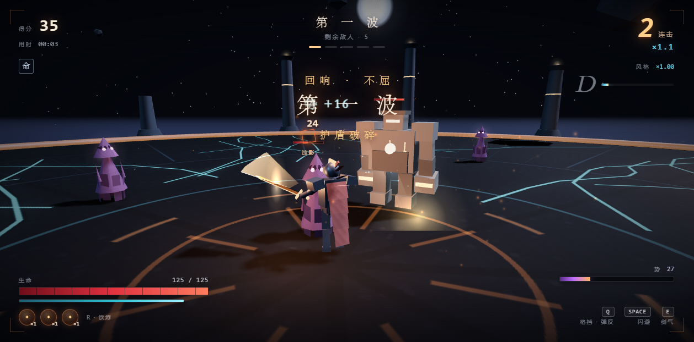
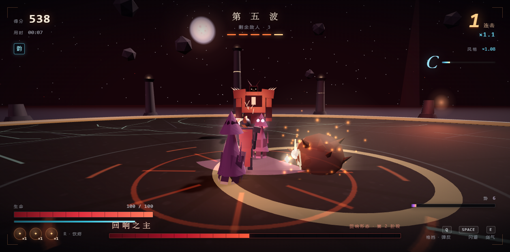
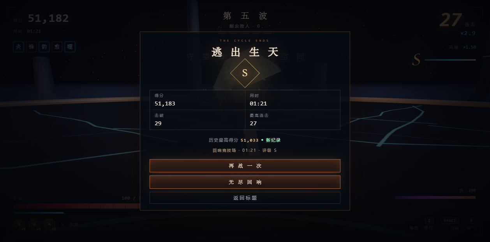
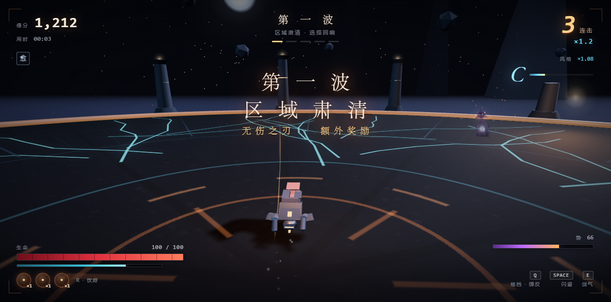
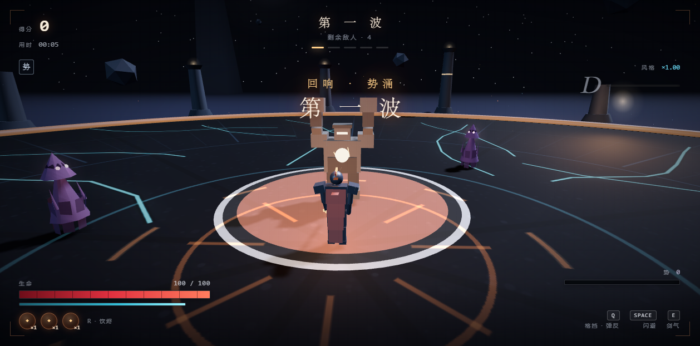

# 余烬之刃：回响轮回 · EMBER BLADE v2.0.2

一款可在浏览器直接游玩的**第三人称 3D 剑斗动作 Roguelite**。单文件、离线可玩、无需安装任何环境。

> 🎮 **在线游玩**：<https://cccfeiyyy.github.io/ember-blade/>  
> 📦 **项目仓库**：<https://github.com/cccfeiyyy/ember-blade>

## 开始游玩

**方式一：在线即点即玩** → 打开 <https://cccfeiyyy.github.io/ember-blade/>

**方式二：离线单文件** → 双击打开 **`index.html`**（推荐 Chrome / Edge 最新版，桌面端；也可从仓库直接下载该文件）。

- 点击「开始战斗」后先选择第一道「回响」构筑，随后浏览器会锁定鼠标视角；按 `Esc` 暂停。
- 建议佩戴耳机：音乐与音效均为实时合成，无外部音频文件。
- 传送门 / 风格 / 回响构筑 / 无尽模式均在单文件内完整实现。

## 操作

| 按键 | 动作 |
| --- | --- |
| `W A S D` | 移动（相对镜头） |
| 鼠标移动 | 第三人称视角，滚轮调整距离 |
| 鼠标左键 | 轻斩 · 三段连击 |
| 鼠标右键 | 重斩 · 破防（消耗体力 30） |
| `Space` | 闪避翻滚 · 无敌帧（消耗体力 25） |
| `Q` | 格挡；在受击瞬间按下可**精准弹反**（硬直敌人、反弹弹幕） |
| `E` | 剑气 · 远程穿透 |
| `F` | 烬灭 · 势能满时释放的全屏爆发 |
| `R` | 饮烬 · 回复 40 生命（共 3 瓶） |
| `Tab` | 锁定 / 解除锁定最近敌人 |
| `1` / `2` / `3` | 选择回响祝福（也可点击卡牌） |
| `Esc` | 暂停 / 继续（含灵敏度、音量、反转Y、画质设置） |
| `M` | 静音 |

## v2.0 新增玩法

### 回响构筑（Roguelite）
- 开局及每波肃清后，从 **3 张回响卡**中三选一；共 **22 种祝福**，分普通 / 稀有 / 史诗三档，可叠加。
- 构筑方向：轻/重斩强化、剑气、灼烧、荆棘反伤、吸血、完美余音、时之砂、无限连、势满增伤、双刃攻速、向死而生（一次免死）等。
- 已获祝福显示在 HUD 左上角，鼠标悬停可查看说明。

### 精准弹反 + 格挡
- `Q` 举剑格挡：正面减伤约 70%，但持续消耗体力，体力耗尽会架势崩溃。
- 受击前 0.2 秒内按下 `Q` 触发**完美弹反**：无伤、硬直敌人、反弹咒眼弹幕、大量回势能，并触发慢动作与风格加成。

### 风格评级（D → S）
- 通过连击、完美闪避/弹反、处决、必杀等行为积累风格值，评级 D/C/B/A/S，提供最高 **×1.5 得分倍率**；闲置会随时间衰减。

### 处决
- 敌人生命低于阈值时进入「破绽」，血条变金并显示「处决」；下一击直接处决，回复生命并获得高额分数与风格值。

### Boss 二阶段 · 回响形态
- 无面守望者在 50% 生命时进入二阶段：**竞技场转为赤红**、音乐切换为 boss2，并解锁**剑雨、三连冲击波、幻影突进**；25% 生命进入终焉狂怒。

### 精英与爆裂者
- 精英敌人（迅捷 / 护盾 / 狂怒）拥有金色/青色/红色光环，掉落更丰厚。
- 新敌人**爆裂者**：高速接近后自爆，击杀或被击退都要小心范围伤害。

### 攻击预警（v2.0.1）
- 所有敌人的近战/范围攻击都会在地面显示**白色攻击范围 + 红色蓄力填充**：红色填满白色范围时立刻出手。
- 预警范围与实际伤害判定一致，覆盖蚀影横扫、石卫震地、Boss 四种范围攻击与剑雨、爆裂者自爆、咒眼落点；最后阶段会脉冲闪烁提示闪避时机。

### 掉落与资源
- 敌人有概率掉落治疗余烬或势能结晶，靠近会自动磁吸拾取。

### 无尽回响
- 通关主线后可进入**无尽模式**：波次无限递进、精英概率提升、每 5 波出现强化守望者。
- 最高得分 / 无尽最深波次通过 `localStorage` 永久保存，并显示在标题页与结算页。

## 敌人

| 敌人 | 特点 |
| --- | --- |
| 蚀影 | 高速游荡、突进撕咬，攻击前有紫红预警扇面 |
| 石卫 | 重甲慢速，抬臂砸地，红色范围圈预警 |
| 咒眼 | 悬浮施法，三连弹幕，优先保持距离（可弹反） |
| 爆裂者 | 自爆型，接近后蓄力爆炸，范围预警圈 |
| 无面守望者 | 三连横扫、蓄力重斩、震地冲击波、召唤援军；50% 进入回响形态，25% 终焉狂怒 |

## 画面预览

| | |
| --- | --- |
|  |  |
|  |  |
|  |  |
|  | |

## 技术说明

- 整个游戏（约 916 KB）打包在单个 `index.html` 内：Three.js r128、全部模型/贴图/音乐/音效均由代码程序化生成，无任何外部资源请求，断网可玩。
- 针对性能较弱的电脑内置自动画质降级；可在暂停菜单手动切换「自动 / 高 / 低」画质。
- 源代码与构建脚本位于 `.dev/` 目录：`src/*.js` 为分模块源码（含 `blessings.js` 数据驱动祝福表），`node .dev/build.mjs` 可重新生成 `index.html`。
- 自动化验收：无头 Chrome + CDP（v1 自建测试脚本 + v2 QA 框架 `.dev/qa/`），覆盖祝福、弹反、处决、Boss 二阶段、无尽、掉宝、设置持久化与完整通关。
- 工作室流程产物见：
  - [游戏概念 v2](design/gdd/game-concept-v2.md)、[系统索引](design/gdd/systems-index.md)、[祝福系统 GDD](design/gdd/blessing-system.md)、[弹反与风格 GDD](design/gdd/parry-style-system.md)、[Boss 二阶段与无尽 GDD](design/gdd/boss-phase2-endless.md)、[敌人与掉落 GDD](design/gdd/enemies-and-drops.md)
  - [架构总览](docs/architecture/master.md)、[ADR-001](docs/architecture/adr-001-single-file-threejs.md)、[ADR-002](docs/architecture/adr-002-data-driven-blessings.md)、[ADR-003](docs/architecture/adr-003-save-endless.md)、[管控清单](docs/architecture/control-manifest.md)
  - [QA 计划](production/qa/qa-plan-v2.md)、[QA 报告 v2.0.0](production/qa/qa-report-v2.md)、[QA 报告 v2.0.1 / v2.0.2 附录](production/qa/qa-report-v2.0.1.md)、[试玩报告](production/playtests/playtest-v2.md)、[缺陷记录](production/qa/bugs/README.md)
  - [Sprint v2](production/sprints/sprint-v2.md)、[阶段关卡](production/gates/gate-v2-release.md)

## 仓库结构

```
.
├─ index.html              # 最终构建：单文件游戏（v2.0.2，双击即玩）
├─ README.md / CHANGELOG.md / LICENSE
├─ screenshots/            # 宣传/验收截图
├─ design/                 # GDD × 6、UX 规格、Art Bible
├─ docs/architecture/      # 架构总览 + 3 份 ADR + 控制清单
├─ production/             # Epic / Story / Sprint / Gate / QA 报告 / 试玩
└─ .dev/                   # 源码、构建与自动化测试工具
   ├─ src/*.js             # 8 个源码模块（world / combat / game / hud / …）
   ├─ template.html        # 单文件模板
   ├─ build.mjs            # 构建脚本：内联 Three.js + CSS + 源码 → index.html
   ├─ cdp.mjs              # 无头 Chrome CDP 小工具
   └─ qa/                  # 零依赖无头验收框架（9+ 套件）
```

> QA 的原始大截图与实验数据（约 30MB）保留在本地，未纳入仓库；仓库内保留 QA 计划、报告、缺陷与试玩记录。

## 构建与自动化测试

```powershell
# 重新构建单文件 index.html
node .dev/build.mjs

# 无头 Chrome 全量验收（需要本机安装 Chrome）
node .dev/qa/run-v2-qa.mjs
node .dev/qa/run-v2-qa.mjs --only=02,03,08   # 只跑指定套件
node .dev/qa/run-v2-qa.mjs --headed          # 有头模式观察

# 单次手动调试：加载 index.html，执行 eval 脚本并截图
node .dev/cdp.mjs "file:///.../index.html" out/ [eval.js] [waitMs]
```

QA 结果摘要：v2.0.0 主验收 233 项 FAIL 0；v2.0.1 全量 265 项 FAIL 0；v2.0.2 聚焦复验 47 项 FAIL 0；控制台错误 0。

## 更新记录

**v2.0.2（翻滚贴地收尾）**
- 翻滚峰值阶段增加离地补偿并在翻滚中段收剑，整模型可见部件全程不穿地；位移 3.0m、头/膝 minY>0、结算归位均保持。

**v2.0.1（翻滚与预警打磨）**
- 修复翻滚动画穿入地面、翻滚后回落穿地的问题；翻滚改为收身滚动，任何角度不入地。
- 翻滚位移改为精确 3.0m 战术翻滚（祝福可延长），位移与动画同步，无敌帧 0.02~0.28s。
- 敌人攻击预警升级：白色范围底 + 白色描边 + 红色蓄力填充，红色填满即出手；范围与实际判定对齐，末段脉冲提示。
- 修复切换波次/重开/进入无尽时地面预警圈残留。

**v2.0.0（回响轮回）**
- 新增回响祝福构筑（22 种，三选一，初始 + 每波）。
- 新增 Q 格挡 / 精准弹反、D→S 风格评级、处决系统。
- 新增 Boss 50% 二阶段：赤红竞技场、剑雨、三连冲击波、突进、25% 狂怒。
- 新增精英词缀、爆裂者、掉落拾取、治疗/势能结晶磁吸。
- 新增无尽回响模式与本地最高纪录（localStorage）。
- 新增暂停设置：反转纵向视角、画质档位（灵敏度/音量原有保留并持久化）。
- 新增 15 种程序化音效与 boss2 动态音乐层。

**v1.0.1**
- 修正第三人称移动左右方向基向量；相机改为输入/渲染双层平滑，修复指针锁定瞬间镜头乱跳。

## 制作说明

本项目为「50 元 token 预算、全流程自主决策」的一次性游戏实验：
从概念、玩法、数值、角色/场景建模、特效、程序化音乐音效、UI/UX 到测试与打磨，全部由 AI 在预算内独立完成；v2.0 扩展引入 Agent Teams 并行（设计文档 / 音频 / QA）与完整工作室流程产物。

**《余烬之刃：回响轮回》v2.0.2**
