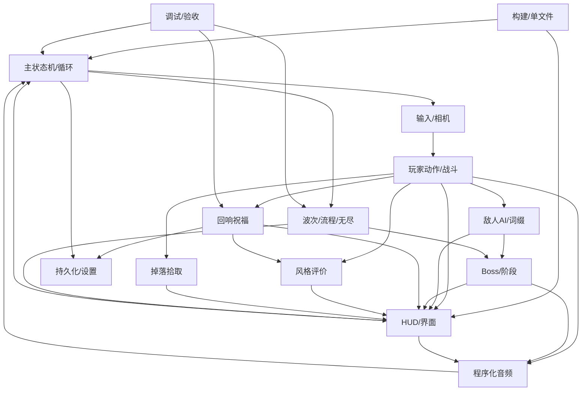

# 《余烬之刃》v2.0 系统索引（Systems Index）

> **Status**: Approved
> **Author**: design-docs
> **Last Updated**: 2026-10-19
> **Template**: Systems Index（/map-systems）
> **Scope**: v1.0.1 既有系统 + v2.0 增量系统；仅覆盖实现范围，非愿景清单

---

## 1. 系统枚举

### 1.1 分层定义

| 层 | 含义 | 变化风险 |
| --- | --- | --- |
| **Foundation 基础层** | 所有系统都依赖的运行时、状态、输入、构建、存档 | 高：改动波及全局 |
| **Core 核心层** | 直接构成战斗与流程循环的系统 | 中：改动影响手感与平衡 |
| **Feature 特性层** | v2 新增的构筑、评价、Boss 阶段、模式扩展 | 中：可独立回滚 |
| **Presentation 表现层** | HUD、音频、VFX、结算等呈现与反馈 | 低：不改变规则 |

### 1.2 枚举表

| ID | 系统 | 层 | 优先级 | 对应 GDD / 文档 | 源码入口 | v2 状态 |
| --- | --- | --- | --- | --- | --- | --- |
| SYS-01 | 主状态机与主循环（boot/title/playing/paused/dead/victory） | Foundation | MVP | 本文档 §4.1 | `.dev/src/game.js` | 既有，v2 需扩展 `endless` 状态与祝福暂停 |
| SYS-02 | 输入、指针锁定与第三人称相机 | Foundation | MVP | `design/ux/hud-and-blessing-screen.md` §7 | `.dev/src/game.js` | 既有，v2 增加反转 Y 轴与 Q 键 |
| SYS-03 | 玩家动作与战斗资源（连击/重斩/闪避/剑气/势能/饮烬） | Core | MVP | `parry-style-system.md` §2–4 | `.dev/src/combat.js` | 既有，v2 增加格挡/弹反/处决 |
| SYS-04 | 敌人 AI、精英词缀与新敌人 | Core | MVP | `enemies-and-drops.md` §2–4 | `.dev/src/combat.js` | 既有，v2 增加 3 词缀 + 爆裂者 |
| SYS-05 | 波次、流程与无尽模式 | Core | MVP | `boss-phase2-endless.md` §4 | `.dev/src/combat.js`、`game.js` | v1 5 波，v2 增加无尽 |
| SYS-06 | Boss「无面守望者」与阶段转换 | Feature | MVP | `boss-phase2-endless.md` §2–3 | `.dev/src/combat.js`、`world.js` | 既有单阶段，v2 二阶段/狂怒 |
| SYS-07 | 回响祝福构筑 | Feature | MVP | `blessing-system.md` | `.dev/src/blessings.js` | **v2 新增** |
| SYS-08 | 风格评价 D/C/B/A/S | Feature | MVP | `parry-style-system.md` §5–6 | `.dev/src/combat.js`、`hud.js` | **v2 新增** |
| SYS-09 | 掉落与拾取 | Feature | MVP | `enemies-and-drops.md` §5 | `.dev/src/combat.js` | **v2 新增** |
| SYS-10 | HUD、菜单、祝福界面与结算 | Presentation | MVP | `design/ux/hud-and-blessing-screen.md` | `.dev/src/hud.js`、`style.css`、`template.html` | 既有，v2 大幅扩展 |
| SYS-11 | 程序化音频（SFX + 音乐层） | Presentation | MVP | `design/art-bible-v2.md` §7、`production/epics/v2/EPIC.md` | `.dev/src/audio.js` | 既有，v2 新增 16 SFX + boss2 层 |
| SYS-12 | 持久化（无尽纪录 + 设置） | Foundation | MVP | `docs/architecture/adr-003-save-endless.md` | `.dev/src/game.js` | **v2 新增** |
| SYS-13 | 构建与单文件打包 | Foundation | MVP | `docs/architecture/adr-001-single-file-threejs.md` | `.dev/build.mjs`、`template.html` | 既有，v2 增加 `/*__BLESSINGS__*/` |
| SYS-14 | 调试接口与自动化验收 | Foundation | Should | `docs/architecture/master.md` §6 | `game.js` 的 `window.__DEBUG`、`.dev/cdp.mjs` | 既有，v2 需扩展祝福/无尽/弹反状态 |

> 系统总数 **14**（v2 新增 4：SYS-07/08/09/12；大幅改造 5：SYS-01/02/05/06/10；表现扩展 1：SYS-11）。

---

## 2. 依赖关系图

### 2.1 双向一致性说明

| 边 | 正向职责 | 反向约束（不得越界） |
| --- | --- | --- |
| S03 → S07 | 战斗事件（命中/弹反/处决/受击）向祝福提供触发点与计数 | 祝福不得直接改写战斗时序（如攻击帧、无敌帧），只能通过 `P.mods` 乘区 |
| S07 → S08 | 祝福可提供风格加成（如 `perfectBuff` 影响弹反/闪避后的增伤计时） | 风格倍率不得反向修改祝福获取概率，避免正反馈死循环 |
| S07 → S12 | 祝福列表与选择结果不落盘（单局状态），仅设置/无尽纪录落盘 | 存档不得写入局内构筑，防止刷新作弊 |
| S05 → S06 | 无尽模式复用 Boss 生成与音乐切换 | Boss 系统不得感知「主流程/无尽」差异，仅通过参数（HP 倍率、词缀）区分 |
| S10 → S01 | HUD 触发祝福选择时暂停主循环 | HUD 不得直接改 `S.mode` 以外的游戏状态；模式切换统一走 `setMode` |
| S11 ← S03/S06 | 音频订阅战斗事件（`audio.sfx(name)`） | 音频不得参与判定；缺失音频名称必须静默降级（v2 已实现 unknown-safe） |

---

## 3. 优先级与设计顺序

### 3.1 优先级分配

| 优先级 | 系统 | 理由 |
| --- | --- | --- |
| **MVP（必须）** | SYS-01/02/03/04/05/06/07/08/09/10/11/12/13 | v2 的「构筑 + 弹反 + 二阶段 + 无尽」闭环缺一不可；构建/持久化是单文件产品底线 |
| **Should（应做）** | SYS-14 | 无头验收接口决定能否自动证明「可通关/无尽可推进」，影响交付可信度 |
| **Nice（如有余量）** | 色盲档、结算新增统计、无尽 Boss 词缀 | 不阻塞 v2 发布 |

### 3.2 设计顺序（GDD 撰写顺序）

1. **SYS-01/02** 主流程与输入（明确祝福暂停、设置项、Q 键绑定）
2. **SYS-03** 玩家动作（格挡/弹反/处决与既有状态机的插入点）
3. **SYS-07** 回响祝福（数据契约与 `mods`，被 SYS-08/03 依赖）
4. **SYS-08** 风格评价（事件源依赖 SYS-03/07）
5. **SYS-04** 敌人与词缀、**SYS-09** 掉落（依赖 SYS-03 的命中/处决事件）
6. **SYS-06** Boss 二阶段（依赖 SYS-04/05）
7. **SYS-05** 波次与无尽（依赖 SYS-06 的 Boss 参数化）
8. **SYS-10** HUD/界面、**SYS-11** 音频（最后对齐全部事件与文案）
9. **SYS-12** 持久化、**SYS-13/14** 构建与验收（贯穿，最后验收）

### 3.3 高风险系统（需优先验证）

| 系统 | 风险 | 验证方式 |
| --- | --- | --- |
| SYS-03 玩家动作 | 弹反窗口与既有状态机（dodge/attack/hurt）冲突，可能出现无敌帧叠加或取消滥用 | CDP 断言：`playerState` 序列、弹反窗口内受击结果、格挡体力耗尽破防 |
| SYS-07 祝福 | 22 条 `apply` 的乘法叠加导致极端数值（如双刃 + 攻速祝福） | 单元式脚本遍历全部祝福组合后的 `P.mods` 数值边界；上限 clamp |
| SYS-05 无尽 | 波次生成公式在 10 波后可能敌人过多导致掉帧 | CDP 推进到第 15 波检查 `enemiesAlive` 上限与帧率采样 |
| SYS-10 HUD | 祝福界面与结算/暂停/死亡叠加态冲突（如死亡瞬间弹出祝福） | CDP 在清波瞬间击杀玩家，断言界面优先级 |

---

## 4. 跨系统契约

### 4.1 事件契约（战斗 → 表现/构筑）

| 事件 | 触发点 | 消费方 | 载荷 |
| --- | --- | --- | --- |
| `attack:light/hit` | `damageEnemy()` | 风格、祝福（灼烧/连击）、HUD 伤害数字 | 伤害、是否重斩、目标类型 |
| `parry:perfect` | 弹反判定成功 | 风格、势能、音频 `parry`、慢动作、HUD 提示 | 来源类型（近战/弹幕/冲击波）、是否精英 |
| `parry:block` | 普通格挡命中 | 体力扣除、音频 `block`、HUD 火花 | 伤害值、是否破防 |
| `execution` | 破绽敌人被近战命中 | 回血、风格、音频 `execute`、得分 | 敌人类型、击杀得分 |
| `style:rankChange` | 风格分跨阈值 | HUD、音频 `styleUp/styleDown` | 旧/新等级 |
| `blessing:offer` | 波次清场/开局 | 祝福界面、音频 `blessingOpen` | 候选 3 条、波次号 |
| `boss:phase2` / `boss:enraged` | Boss HP 50% / 25% | 世界赤红化、音乐 `boss2`、音频 `bossPhase` | HP 比例 |
| `wave:clear` | 敌人清空 | 奖励、祝福选择、HUD | 波次、是否无伤 |
| `run:victory` | Boss 死亡 | 结算、无尽解锁 | 得分、用时、评级 |
| `endless:record` | 无尽死亡 | localStorage、结算页 | 波次、得分、日期 |

### 4.2 数据契约

- `P.mods`：由 `G.recalcBlessingMods(P)` 全量重算，字段见 `blessing-system.md` §3.2；所有消费方必须容错未知字段（加减乘属性不存在的键视为无效）。
- `P.blessings` / `P.blessingCounts`：单局构筑真值；不允许在局外读取。
- `localStorage` schema（详见 ADR-003）：
  - `emberblade.endless.best` = `{ wave, score, kills, time, date, v }`
  - `emberblade.settings.v2` = `{ sens, vol, invertY, quality, muted, v }`
- `window.__DEBUG`：测试与 QA 的唯一自动化入口，扩展字段见 `master.md` §6。

---

## 5. 需求追踪（TR Registry）

> 编号规则 `TR-<系统>-NNN`，被 EPIC/Story 直接引用；完整登记见 `docs/architecture/master.md` §8。

| 系统 | TR 前缀 | 需求数 | 主要需求摘要 |
| --- | --- | --- | --- |
| SYS-01 主流程 | TR-CORE | 4 | `endless` 局内状态、祝福暂停/恢复、结算按钮分流、设置应用时机 |
| SYS-02 输入/相机 | TR-INPUT | 3 | Q 键绑定、反转 Y 轴、画质档位输入 |
| SYS-03 玩家动作 | TR-COMBAT | 8 | 格挡减伤（×0.30）、0.20s 弹反窗口、处决（阈值 24%+加成）、体力破防、硬直 |
| SYS-04 敌人/词缀 | TR-ENEMY | 6 | 迅捷/护盾/狂怒、爆裂者、精英生成概率、随波次缩放 |
| SYS-05 波次/无尽 | TR-WAVE | 5 | 无尽解锁、波次递增、每 5 波 Boss、最高纪录 |
| SYS-06 Boss | TR-BOSS | 5 | 50% 二阶段、赤红竞技场、剑雨、三连冲击波、突进、25% 狂怒 |
| SYS-07 祝福 | TR-BLESS | 7 | 数据表 22 条、三选一、稀有度权重、叠加上限、`mods` 聚合、选择 UI、初始选择 |
| SYS-08 风格 | TR-STYLE | 5 | D→S 阈值、事件加点、衰减、倍率作用于得分/势能、HUD 显示 |
| SYS-09 掉落 | TR-DROP | 3 | 治疗/势能掉落、拾取半径、磁吸/寿命 |
| SYS-10 HUD/界面 | TR-HUD | 7 | 祝福界面、风格条、格挡技能位、设置面板、无尽结算、纪录展示、色盲编码 |
| SYS-11 音频 | TR-AUDIO | 5 | 16 种新 SFX、boss2 音乐层、弹反/处决混音反馈、模式切换 |
| SYS-12 持久化 | TR-SAVE | 3 | 无尽纪录读写、设置读写、异常静默降级 |
| SYS-13 构建 | TR-BUILD | 2 | 单文件构建含 blessings.js、体积上限 |
| SYS-14 调试 | TR-DEBUG | 4 | 弹反/风格/祝福/无尽测试接口 |

---

## 6. 进度追踪（截至 2026-10-19 20:20，v2 构建已产出）

| 系统 | GDD | 架构/ADR | 实现 | QA 证据 | 备注 |
| --- | --- | --- | --- | --- | --- |
| SYS-01 主流程 | ✅ 概念 §7 | ADR-001 | ✅ `game.js` | 🟡 qa-verifier 进行中 | 构建约 926 KB |
| SYS-02 输入/相机 | ✅ UX §7 | ADR-001 | ✅ Q 键/反转 Y/画质 | 🟡 | — |
| SYS-03 玩家动作 | ✅ parry-style §3 | ADR-001 | ✅ 格挡/弹反/处决 | 🟡 | 弹反 0.2s、处决即时 |
| SYS-04 敌人/词缀 | ✅ enemies §4–7 | ADR-001 | ✅ 爆裂者/3 词缀/缩放 | 🟡 | `detonator` |
| SYS-05 波次/无尽 | ✅ boss/endless §4 | ADR-003 | ✅ `getWaveDef`/`makeEndlessWave` | 🟡 | 11%/6.5%/16% |
| SYS-06 Boss | ✅ boss/endless §3 | ADR-001 | ✅ 50%/25% 阶段/赤红/新招式 | 🟡 | — |
| SYS-07 祝福 | ✅ blessing-system | ADR-002 | ✅ `blessings.js` 22 条 | 🟡 | — |
| SYS-08 风格 | ✅ parry-style §4 | ADR-001 | ✅ `STYLE_TIERS` + 事件 | 🟡 | 倍率仅作用于得分 |
| SYS-09 掉落 | ✅ enemies §6 | ADR-001 | ✅ 掉落/拾取 | 🟡 | 上限 26 |
| SYS-10 HUD/界面 | ✅ UX 全文 | ADR-001 | ✅ `hud.js`/模板/样式 | 🟡 | 标题页缺 Q 说明 |
| SYS-11 音频 | ✅ art-bible §10 | ADR-001 | ✅ 16 SFX + boss2 | 🟡 | — |
| SYS-12 持久化 | ✅ ADR-003 | ADR-003 | ✅ 纪录/设置 | 🟡 | 键 `_v2` |
| SYS-13 构建 | ✅ ADR-001 | ADR-001 | ✅ `BUILD OK`（904 KB） | 🟡 | 含 `/*__BLESSINGS__*/` |
| SYS-14 调试/验收 | ✅ master §6 | ADR-001 | ✅ `__DEBUG` v2.0.0 | 🟡 | QA 脚本使用 |

> 图例：✅ 完成 / 🟡 进行中 / ⬜ 未开始。实现依据 `.dev/src/` 与 `index.html`（2026-10-19 20:20）；QA 报告由 `production/qa/` 归档。

---

## 7. 开放问题（v2 实现后更新）

1. 祝福界面期间是否允许查看当前构筑与 Boss 剩余血量？当前：HUD 可见、世界暂停；卡片不显示已持有层数（仅 HUD chip 显示）。
2. 无尽模式是否保留「无伤清波额外选择」？当前：无伤只加 300 分，不额外发祝福。
3. 处决是否对精英生效？当前：生效；Boss 免疫；破绽无时限（即时斩杀，非 4s 窗口）。
4. 风格评价是否跨波保留？当前：保留并继续衰减，不重置。
5. 反转 Y 轴是否影响锁定镜头回正？当前：只反转鼠标 pitch 输入符号，不影响锁定回正。
6. ~~标题页操作说明缺 `Q 格挡·弹反`~~ → **已修复**（`template.html` 已补 Q 与 1/2/3 说明）。
7. 无尽死亡后不显示「再次无尽」按钮（条件 `victory && !endless`），需产品决策是否放开。
