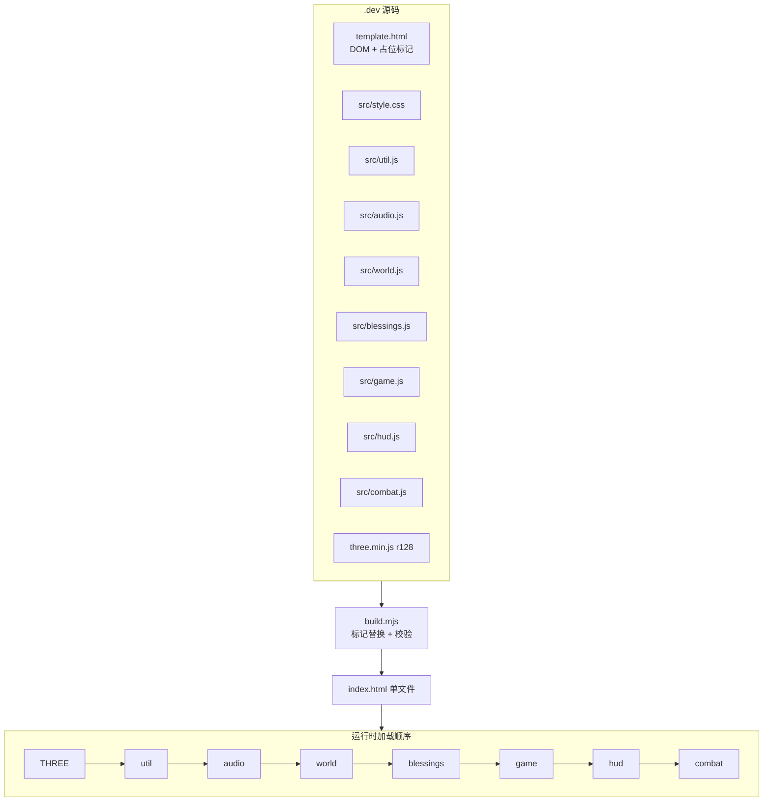

# ADR-001：单文件 Three.js 架构（全局命名空间 + 构建期拼接）

> **Status**: Accepted
> **Date**: 2026-10-19
> **Engine Compatibility**: Three.js **r128**（内嵌，无 npm/打包器）；原生 DOM + WebAudio + Pointer Lock
> **ADR Dependencies**: 无（Foundation 层首个决策）
> **Related**: ADR-002（祝福模块作为新脚本标记接入）、ADR-003（localStorage 持久化）

---

## Context

### Problem Statement
《余烬之刃》的核心产品承诺是「双击一个 `index.html` 即可离线游玩、无需安装」。v2.0 需要在不破坏该承诺的前提下，增量加入祝福构筑、弹反、风格评价、Boss 二阶段、无尽模式与新音频。可选方案从「保持单文件、源码多模块构建期拼接」到「引入打包器/外部资源/服务端」不等。

### Constraints
- 分发形态：单个 `index.html`，无外部请求，断网可玩。
- 体积：≤1 MB（v1 约 808 KB）。
- 预算：50 元 token 的一次性实验，构建链必须极简（仅 `node .dev/build.mjs`）。
- 浏览器：桌面 Chrome / Edge；无 polyfill 网络加载。
- 团队：AI 多代理并行改源码（Lead 改 game/combat/hud/world，音频代理独占 audio.js），要求**文件级所有权清晰、合并冲突最小**。

### Requirements
- TR-BUILD-001：构建产物包含 `blessings.js`（新标记 `/*__BLESSINGS__*/`），无残留标记。
- TR-BUILD-002：单文件体积 ≤1 MB。
- TR-CORE-001：主循环独立于渲染，支持暂停/慢动作/命中停顿。
- TR-HUD-001：HUD 使用 DOM 覆盖层，支持实时 DOM 更新与 CSS 动画。
- TR-AUDIO-001：程序化音频，无外部音频文件。

---

## Decision

### 架构

- **模块形态**：每个 `src/*.js` 是一个 IIFE，向全局 `window.G` 挂载命名空间（`G.util/G.audio/G.world/G.game/G.hud/G.combat/G.BLESSINGS` 等）。模块间只通过 `G.*` 通信。
- **构建**：`build.mjs` 读取 `template.html`，按标记替换 `/*__CSS__*/`、`/*__THREE__*/`、`/*__UTIL__*/`、`/*__AUDIO__*/`、`/*__WORLD__*/`、`/*__BLESSINGS__*/`、`/*__GAME__*/`、`/*__HUD__*/`、`/*__COMBAT__*/`，并校验：标记必须存在、模块内容不得含 `</script>`、无残留 `/*__`。
- **HUD 方案**：`canvas#game-canvas` 承载 3D 渲染；DOM 覆盖层（`#hud`、`#title-screen`、`#blessing-screen` 等）承载 HUD/菜单，由 `hud.js` 操作 DOM、`style.css` 提供视觉。
- **状态**：`game.js` 创建 `S/P/C/D/CFG` 并挂到 `G.game`，所有模块共享引用；`window.__DEBUG` 暴露自动化接口。

### Key Interfaces
- 构建标记：`/*__BLESSINGS__*/`（v2 新增，位置在 world 之后、game 之前）。
- 运行时命名空间：`window.G = { util, world, audio, game, hud, combat, BLESSINGS, ... }`。
- 脚本顺序契约：`combat` 最后加载；`blessings` 必须先于 `game`。

---

## Alternatives Considered

### Alternative 1：Vite/webpack 多文件打包
- 优点：模块化、tree-shaking、开发体验好。
- 拒绝原因：引入 node_modules 与构建依赖，违反「极简构建 + 单文件离线」；本项目的收益不足以抵消复杂度与 token 成本。

### Alternative 2：ES Modules（`<script type="module">` + import）
- 优点：原生模块化。
- 拒绝原因：`file://` 协议下 ES Modules 受 CORS 限制，双击打开会失败；必须起本地服务器，破坏核心承诺。

### Alternative 3：Canvas 内绘制 HUD（而非 DOM）
- 优点：单一渲染面、截图一致性更高。
- 拒绝原因：需要自建文本测量/布局/动画系统，v1 已用 DOM HUD 并验证可行；v2 的祝福卡/设置面板用 DOM 实现成本远低。

### Alternative 4：CDN 引入 Three.js
- 拒绝原因：需要网络、不可离线、版本漂移风险。

---

## Consequences

### Positive
- 分发零成本、离线可玩；构建仅一次文本拼接，秒级完成。
- 多代理可并行修改不同 `src/*.js`，构建期拼接避免合并冲突。
- DOM HUD 让 v2 新增界面（祝福卡、设置、结算纪录）实现成本低。
- 无第三方运行时依赖，体积与安全面可控。

### Negative
- 全局命名空间与隐式加载顺序带来耦合；模块间无静态类型检查。
- 单文件源码体积增长（`combat.js` 预计 2,600+ 行），可维护性下降。
- 浏览器缓存粒度为整页；任何改动都需重新加载整个文件（可接受，单机游戏）。

### Risks
- 构建标记遗漏/顺序错误 → 运行时报 `undefined`。缓解：`build.mjs` 校验缺失标记；运行顺序在文档与构建脚本中双重登记。
- 全局状态被越权修改 → 状态不一致。缓解：control manifest 明确「外部模块不得直接改 `S.mode`」等规则；`__DEBUG` 只读/受控写。

---

## GDD Requirements Addressed
- TR-BUILD-001/002、TR-CORE-001、TR-HUD-001/004/005、TR-AUDIO-001、TR-DEBUG-001~004。

## Performance Implications
- 单文件解析成本一次性；运行时无模块加载开销。
- DOM HUD 每帧仅更新文本/宽度（既有实现），未引入布局抖动；祝福界面为事件驱动，不参与每帧更新。
- 构建体积目标 ≤1 MB：v2 预计 +60–100 KB（blessings 10 KB + audio 14 KB + game/hud/combat 增量 + css 10 KB）。

## Migration Plan
1. 新增 `src/blessings.js` 与 `template.html` 的 `/*__BLESSINGS__*/` 标记。
2. `build.mjs` 的 `parts` 增加 `/*__BLESSINGS__*/`（顺序在 WORLD 后、GAME 前）。
3. 重新构建并跑 QA 冒烟（双击打开、标题→战斗→胜利/死亡→刷新）。
4. 回滚策略：删除标记与文件即可回到 v1 构建（v2 逻辑均有独立函数入口）。

## Validation Criteria
- [ ] `node .dev/build.mjs` 输出 `BUILD OK`，体积 ≤1 MB。
- [ ] 构建产物中无 `/*__` 残留；`blessings.js` 内容存在。
- [ ] 双击 `index.html`（`file://`）可进入标题并开始游戏。
- [ ] 浏览器控制台无 `G.*` undefined 错误。
- [ ] 无头 Chrome CDP 全流程脚本通过（标题→战斗→Boss→胜利→无尽）。

## Related Decisions
- ADR-002：祝福模块以同一构建机制接入，不新增打包器。
- ADR-003：持久化使用浏览器 localStorage，不引入服务端。
