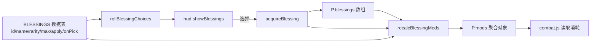

# ADR-002：数据驱动祝福与统一 `mods` 聚合

> **Status**: Accepted
> **Date**: 2026-10-19
> **Engine Compatibility**: 纯 JavaScript（ES2015+），无引擎 API 依赖；与 Three.js r128 运行时共存
> **ADR Dependencies**: ADR-001（加载顺序与全局命名空间）
> **Related**: ADR-003（祝福不落盘）

---

## Context

### Problem Statement
v2 需要在单局内提供 20+ 条可叠加祝福，并让战斗系统读取它们的效果。若每条祝福都用 `if/else` 或事件回调硬编码在 `combat.js` 中，新增/调整祝福将需要改动战斗核心，且难以保证「重算一致、可回滚、可测试」。

### Constraints
- 祝福效果跨多个系统（伤害、移速、体力、势能、药水、处决阈值、风格事件等），必须有统一聚合对象。
- 祝福在战斗中频繁读取（每次命中/受击），聚合结果必须 O(1) 读取。
- 叠加上限、稀有度权重、候选抽取需要集中管理，便于调参。
- 单文件构建：新增模块必须能被 `build.mjs` 以简单标记拼接（ADR-001）。
- 多代理并行：祝福数据由设计/实现侧集中维护，HUD 只读展示。

### Requirements
- TR-BLESS-001：22 条祝福数据表、三档稀有度。
- TR-BLESS-002：开局 + 每波清场三选一。
- TR-BLESS-003：稀有度权重随波次漂移。
- TR-BLESS-004：每条祝福独立叠加上限，满层剔除。
- TR-BLESS-005：`mods` 重算幂等。
- TR-BLESS-006：三选一 UI 支持鼠标与 1/2/3。
- TR-COMBAT-001：战斗读取 `P.mods` 生效。

---

## Decision

### 架构

### 决策内容

1. **新增 `src/blessings.js`**（IIFE，构建标记 `/*__BLESSINGS__*/`，加载于 `world.js` 之后、`game.js` 之前）。
2. **数据表**：`const BLESSINGS = [ { id, name, icon, rarity, max, desc, flavor, apply(P), onPick?(P) }, ... ]`，共 **22 条**（普通 8 / 稀有 8 / 史诗 6）。数据表是祝福数值的唯一真源。
3. **稀有度**：`RARITY = { common: {weight:62,...}, rare: {weight:28,...}, epic: {weight:10,...} }`；`rarityWeight(rarity, wave)` 做波次漂移（普通 `max(18, 62-2w)`、稀有 `min(52, 28+2.5w)`、史诗 `min(40, 10+3.5w)`）。
4. **抽取**：`rollBlessingChoices(P, wave, count=3)`：候选 = 未达 `max` 的祝福；先按稀有度权重掷骰，再在该稀有度内随机；不重复；`guard` 上限 200 次；返回数组（可能少于 3）。
5. **聚合**：`blessingModsBase()` 返回默认 `mods`（每个修正字段带默认值）；`recalcBlessingMods(P)` 先重置再对每条已选祝福执行 `apply(P)`，并派生 `maxHp/maxStamina/maxPotions` 上限后 clamp 当前值。**全量重算保证幂等**。
6. **应用**：`game.js` 的 `acquireBlessing(b)`：push → `recalc` → `onPick` → 补正 HP → HUD chip → `addStyle(4)` → 提示文案。
7. **公开 API**：`G.BLESSINGS`、`G.BLESSING_RARITY`、`G.getBlessing(id)`、`G.blessingModsBase()`、`G.recalcBlessingMods(P)`、`G.rollBlessingChoices(P, wave, count)`。

### Key Interfaces
- `mods` 字段：`lightMul/heavyMul/waveMul/waveCdCut/wavePierce/speedMul/dodgeDistMul/momentumMul/potionMax/maxHpBonus/staminaMaxBonus/staminaRegenMul/waveHealPct/waveHealFlat/execThresholdBonus/executeHealBonus/perfectBuff/burnPerHit/thornDamage/comboWave/storm/lifesteal/timeSand/comboWindowBonus/keepCombo/damageTakenMul/atkSpeedMul/echoLord/deathDefy/auraHeal`（`auraHeal` 预留）。
- `apply(P)` 通过内部 `mul(P,key,v)` / `add(P,key,v)` 修改 `P.mods`；禁止直接改 `P` 的运行时字段（除 `onPick` 的一次性补正）。
- 战斗侧读取约定：乘法字段（`*Mul`）直接相乘；加法字段（`*Add/Bonus/Flat`）求和后使用；`damageTakenMul` 为受伤乘区。

---

## Alternatives Considered

### Alternative 1：每条祝福硬编码进 `combat.js`
- 优点：直观、无抽象层。
- 拒绝原因：新增/调整祝福需改战斗核心；跨系统效果散落；无法集中做叠加上限与抽取；测试困难。

### Alternative 2：事件驱动（每条祝福订阅 `onHit/onKill/onWaveClear` 回调）
- 优点：表达力强，适合复杂触发型效果。
- 拒绝原因：v2 祝福以「持续修正」为主，事件订阅需要生命周期管理（取消订阅、重算时清理），复杂度高于收益；少量触发型祝福（`comboWave/storm/deathDefy/timeSand`）通过 `mods` 计数字段 + 战斗侧判断即可。

### Alternative 3：运行时组合（装饰器/Proxy 修改战斗函数）
- 拒绝原因：调试困难、性能不确定、与既有 IIFE 风格不兼容。

### Alternative 4：把祝福数据放 JSON 外部文件
- 拒绝原因：违反单文件零外部资源；JSON 内联到 JS 与数据表等价。

---

## Consequences

### Positive
- 祝福数值集中，新增祝福只改 `blessings.js` 数据表（+ 若引入新 `mods` 字段则改 base + 消费方）。
- 全量重算确保叠加/顺序无关、幂等，便于测试（重复 `recalc` 数值不变）。
- 稀有度权重/上限/抽取集中可调，平衡迭代成本低。
- HUD 与战斗共享同一数据源，避免「描述与效果不一致」。

### Negative
- `mods` 字段持续增长（当前约 30 个），消费方需要知道字段语义；拼写错误不会在编译期发现。
- 全量重算对每次获取祝福是一次 O(已选数量) 操作（≤10 次，成本可忽略）。
- 触发型效果仍需战斗侧代码配合，并非纯数据驱动。

### Risks
- 乘法叠加产生极端数值（如多重 `*Mul` 叠满）。缓解：叠加上限、史诗唯一、`maxHp` 下限 `max(50,…)`；发版前做组合遍历检查。
- 战斗侧漏读某字段导致「祝福无效」。缓解：验收标准逐字段；`__DEBUG` 暴露 `mods` 供自动化断言。
- 新增祝福使用的字段未在 `blessingModsBase()` 中初始化 → `NaN`。缓解：control manifest 要求「新字段必须先入 base + 文档登记」。

---

## GDD Requirements Addressed
- TR-BLESS-001~007、TR-COMBAT-001、TR-HUD-001、TR-STYLE-001（祝福 +4 风格分）。

## Performance Implications
- 数据表 22 条，常驻内存可忽略；抽取每次最多 200 次循环，仅在波次间触发。
- `recalc` 在每次选择时执行（≤10 次/局），对帧率无影响。
- 战斗帧内仅读取 `P.mods` 数值字段，O(1)，无对象分配。

## Migration Plan
1. 新增 `src/blessings.js` 与构建标记（ADR-001）。
2. `game.js` 初始化 `P.blessings=[]`、`P.blessingCounts={}`、`P.mods=G.blessingModsBase()`；`resetAll()` 中重算。
3. `hud.js` 实现 `showBlessings/hideBlessings/pickBlessingCard/addBlessingChip`。
4. `combat.js` 逐字段消费 `P.mods`（伤害、体力、势能、药水、处决、灼烧/风暴/吸血等）。
5. 校验：22 条全部可抽取；`recalc` 幂等；三选一流程可用。
6. 回滚：移除 `blessings.js` 与标记、还原 `P.mods` 读取处 → 回到 v1。

## Validation Criteria
- [ ] `G.BLESSINGS.length === 22`，稀有度分布 8/8/6。
- [ ] 每条祝福的 `max` 生效：满层后不再进入候选。
- [ ] 同一祝福叠 2 层后效果按乘法叠加（如锋锐 ×1.3225）。
- [ ] `recalc` 连续调用 10 次数值不变。
- [ ] 波次越高，稀有/史诗抽取占比上升（100 次抽样趋势）。
- [ ] 三选一 UI 正常展示 3 条且支持鼠标/数字键。
- [ ] `P.mods` 的所有字段在战斗中有明确消费点（或标注预留）。

## Related Decisions
- ADR-001：模块加载顺序与构建拼接方式。
- ADR-003：祝福不写入存档（仅单局内存）。
