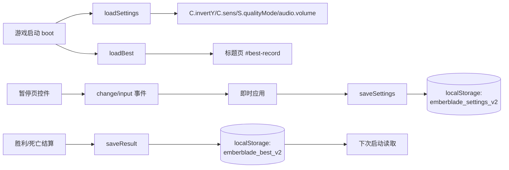

# ADR-003：无尽纪录与设置的 localStorage 持久化

> **Status**: Accepted
> **Date**: 2026-10-19
> **Engine Compatibility**: 浏览器 `localStorage`（同步 API，广泛支持）；无服务端/无网络
> **ADR Dependencies**: ADR-001（单文件离线运行时）
> **Related**: ADR-002（祝福不落盘）

---

## Context

### Problem Statement
v2 新增两类跨会话数据需要保存：**无尽模式最高纪录**（最远波次、最高分、通关次数）与**玩家设置**（灵敏度、音量、反转 Y、画质）。游戏必须保持「无服务端、无账号、断网可玩」，同时不能因为存档异常导致启动失败。

### Constraints
- 仅浏览器本地存储；不得发起网络请求。
- 单文件离线：不能依赖外部文件系统权限。
- 隐私模式/存储配额受限时 `localStorage` 可能抛异常。
- v2 局内进度（当前波次、构筑）**不保存**，刷新即重开（设计选择：短局 + 防作弊）。
- 多代理并行开发：存档读写必须集中在 `game.js`，其他模块不得直接访问 `localStorage`。

### Requirements
- TR-SAVE-001：无尽纪录结构 `{bestScore, endlessBest, endlessLast, storyBest, storyWins, updated}`。
- TR-SAVE-002：设置结构 `{sens, volume, invertY, quality}`。
- TR-SAVE-003：存储异常静默降级，游戏不崩溃。
- TR-WAVE-004：刷新后纪录保留。
- TR-CORE-004：设置修改即时生效并持久化。

---

## Decision

### 架构

### 决策内容

1. **两份独立键**（版本写入键名后缀 `_v2`，避免与未来格式冲突）：
   - `emberblade_best_v2`：`{ bestScore, endlessBest, endlessLast, storyBest, storyWins, updated }`
   - `emberblade_settings_v2`：`{ sens, volume, invertY, quality }`
2. **读取**：`loadBest()` / `loadSettings()` 在 boot 阶段调用；`JSON.parse` 与 `getItem` 全部包在 `try/catch` 中，失败时使用默认值（`S.best=null`、默认设置）。
3. **写入**：
   - `saveResult()` 在胜利/死亡结算时调用：仅在刷新纪录时更新对应字段；`updated = Date.now()`；写失败静默。
   - `saveSettings()` 在控件 `input/change` 时调用（灵敏度、音量、反转 Y、画质）；设置即时应用到 `C/audio/S` 并写入。
4. **无尽纪录语义**：
   - `endlessBest` = 到达的最远波次（不是得分）；
   - `endlessLast` = 最近一次无尽到达波次（即使未破纪录也更新）；
   - `bestScore` = 全局最高分（主流程 + 无尽共用）；
   - `storyBest` / `storyWins` = 主流程最高分与通关次数。
5. **无尽解锁**：不持久化解锁状态，`#endless-btn` 仅在本次运行「胜利结算」显示（`victory && !endless`）。重开游戏后需再次通关才能进入无尽（可接受，局内流程由「胜利」直接衔接）。
6. **不落盘**：局内波次、构筑（`P.blessings`）、风格分、生命、势能、敌人状态；静音状态（M 键）也不持久化（仅本局有效）。
7. **异常降级**：任何 `localStorage` 抛错都不向玩家弹出错误，仅表现为「纪录/设置未保存」；游戏逻辑继续。

### Key Interfaces
- `loadBest()`、`saveResult()`、`updateBestRecordUI()`
- `loadSettings()`、`saveSettings()`、`applyQualityMode()`
- 常量：`BEST_KEY = 'emberblade_best_v2'`、`SETTINGS_KEY = 'emberblade_settings_v2'`
- 消费方：`hud.showEnd()`（`S.best`、`S.newRecord`）、`updateBestRecordUI()`（标题页）、`bindInput()`（设置控件初始化与写入）。

---

## Alternatives Considered

### Alternative 1：IndexedDB
- 优点：容量大、异步。
- 拒绝原因：数据量极小（<1 KB），IndexedDB 的异步复杂度与兼容处理不值得；`localStorage` 同步 API 更适合启动期读取。

### Alternative 2：Cookie / URL 参数
- 优点：简单。
- 拒绝原因：Cookie 体积与隐私语义不合适；URL 参数破坏「双击打开即可玩」的体验。

### Alternative 3：服务端排行榜
- 拒绝原因：无服务器、无网络承诺；隐私与运维成本。

### Alternative 4：不持久化（仅本局显示）
- 拒绝原因：无尽模式的核心动机是「刷新纪录」，不持久化会显著削弱长线动力（P4 再来一局）。

### Alternative 5：保存局内进度（断点续玩）
- 拒绝原因：短局 Roguelite 设计刻意不支持中断续玩；存档局内构筑会引入作弊面与状态迁移复杂度。

---

## Consequences

### Positive
- 零运维、零隐私上传；刷新后仍能看到纪录，支撑无尽挑战动机。
- 设置持久化显著提升可用性（每次打开不用重调灵敏度/音量）。
- 读写集中、全部 try/catch，存储异常不影响游戏启动。
- 键名带版本后缀，未来格式升级可直接新增键，旧数据自然忽略。

### Negative
- 玩家可通过开发者工具篡改 `localStorage` 伪造纪录（单机离线，无排行榜，影响可接受）。
- 隐私模式下纪录不保留（静默降级，非错误）。
- 无尽解锁不持久化，重开需再次通关才能进入（设计取舍）。

### Risks
- 存档字段演进（新增字段）导致旧数据缺字段 → 读取方必须对缺字段容错（`|| default`）。缓解：所有读取使用默认值兜底。
- 写入频率过高（滑条拖动）→ 每次 `input` 写一次。缓解：数据量小、同步写入成本可忽略；如需优化可改为 `change` 时写入。
- 键名拼写不一致 → 纪录丢失。缓解：键名以常量定义、只在 `game.js` 使用。

---

## GDD Requirements Addressed
- TR-SAVE-001~003、TR-WAVE-004、TR-CORE-004、TR-HUD-004/005/006、TR-AUDIO-005。

## Performance Implications
- 启动期两次同步读取（<1 KB），无感知开销。
- 结算时一次写入、设置变更时一次写入；无每帧 I/O。
- 不产生网络请求，不影响帧率。

## Migration Plan
1. `game.js` 增加 `BEST_KEY`/`SETTINGS_KEY` 常量与 `loadBest/loadSettings/saveResult/saveSettings`。
2. `boot()` 中调用 `loadSettings()`；标题显示前调用 `loadBest()` + `updateBestRecordUI()`。
3. `bindInput()` 初始化控件值并绑定写入事件；`applyQualityMode()` 应用画质。
4. 结算页读取 `S.best`/`S.newRecord` 展示。
5. 回滚：忽略读写即可回到 v1（无 v1 持久化状态需要迁移）。

## Validation Criteria
- [ ] 首次启动无存档时使用默认设置，标题显示「尚无纪录」。
- [ ] 通关后 `emberblade_best_v2` 出现，刷新后标题显示最高分/通关次数。
- [ ] 无尽死亡后 `endlessBest/endlessLast` 正确更新。
- [ ] 修改四项设置后刷新，值保持。
- [ ] 隐私模式/禁用存储时不抛未捕获异常，游戏可玩。
- [ ] `localStorage` 只由 `game.js` 访问（全局 grep 校验）。

## Related Decisions
- ADR-001：单文件离线分发（无服务端依赖）。
- ADR-002：祝福为单局状态，不进入存档。
