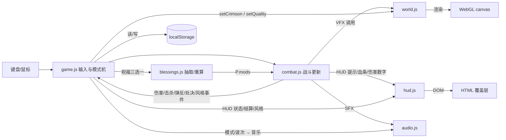

# 《余烬之刃》v2.0 主架构文档（Master Architecture）

> **Status**: Approved（v2 架构基线）
> **Author**: design-docs
> **Last Updated**: 2026-10-19
> **Template**: Master Architecture（/create-architecture）
> **Engine**: Three.js **r128**（内嵌于单文件）· 原生浏览器 API · 无构建依赖（仅 `node .dev/build.mjs` 做文本拼接）
> **GDD 基线**: `design/gdd/game-concept-v2.md`、`systems-index.md`、各系统 GDD
> **控制清单**: `docs/architecture/control-manifest.md`

---

## 1. 文档状态与范围

- 覆盖 v2.0 全部运行时模块、数据流、API 边界与架构决策。
- v1.0.1 的既有架构（单文件 + 全局命名空间 `window.G` + IIFE 模块）保持不变；v2 只做**增量扩展**，不重写。
- 实现以 `.dev/src/` 为准；本文档描述的是「目标架构 + 已落地事实」，差异见 §9。

---

## 2. 引擎知识缺口摘要（Three.js r128）

| 领域 | 风险 | 事实/约束 |
| --- | --- | --- |
| 渲染器 API | LOW | r128 使用 `renderer.outputEncoding = THREE.sRGBEncoding`；**禁止**使用后续版本的 `outputColorSpace`/`useLegacyLights` 等新 API |
| 光照/色彩 | LOW | `ACESFilmicToneMapping`、`toneMappingExposure`、`PCFSoftShadowMap` 在 r128 均可用；v2 赤红竞技场只改 light/material 颜色与强度 |
| 阴影 | LOW | 主方向光 1024² 阴影；低画质档关闭阴影并降低 pixelRatio |
| 指针锁定 | LOW | `canvas.requestPointerLock()` + `pointerlockchange`；已在 v1 处理浏览器锁定尖峰 |
| WebAudio | LOW | `AudioContext` + `GainNode`/`BiquadFilter`/`OscillatorNode` 实时合成；无外部音频文件；需用户手势后 `resume()` |
| localStorage | LOW | 同步 API，隐私模式抛异常 → 必须 try/catch 降级 |
| 性能 | MEDIUM | 单帧预算：60 FPS 为 16.7ms；v1 已有 120 帧 FPS 采样 + 自动降质；v2 新增粒子/灯光量为参数切换而非新增常驻网格 |

> 结论：无 HIGH 风险领域；不需要引擎参考文档升级。任何新 API 使用前必须确认 r128 已存在（本项目无网络依赖，无法加载 polyfill）。

---

## 3. System Layer Map（系统分层）

| 层 | 模块/文件 | 职责 | 允许依赖 |
| --- | --- | --- | --- |
| **Foundation** | `util.js` | 数学/缓动/格式化/角度工具 | 无（依赖已加载的 `THREE`） |
| | `audio.js` | 程序化 SFX + 音乐调度器（AudioEngine 单例） | 无 |
| | `game.js`（状态部分） | `S/P/C/D/CFG` 全局状态、模式机、主循环、存档/设置、祝福/风格/无尽流程 | util/audio/world/blessings/combat/hud（运行时通过 `G.*`） |
| | `build.mjs` + `template.html` | 单文件构建、脚本顺序、构建期校验 | 文件系统 |
| **World** | `world.js` | 渲染器/场景/相机、竞技场、角色与敌人模型工厂、VFX、`setCrimson`/`setQuality` | THREE、util |
| **Core** | `combat.js` | 玩家动作状态机、敌人 AI、Boss、波次、投射物、伤害/风格事件、掉落、处决/弹反判定 | game 状态、world、audio、hud、blessings（读取 `P.mods`） |
| | `blessings.js` | 祝福数据表、稀有度、候选抽取、`mods` 重算 | util（仅 `U.choice`） |
| **Presentation** | `hud.js` | DOM HUD、Boss 条、祝福三选一、风格盒、结算/纪录 | game 状态、audio、blessings（只读视觉元数据） |
| | `style.css` | UI 视觉与动效、响应式 | — |
| | `template.html` | DOM 结构（HUD/标题/暂停/结算/祝福/加载） | — |

**模块加载顺序（构建后脚本顺序）**：
`THREE → util → audio → world → blessings → game → hud → combat`

原因：`combat.js` 最后加载，可安全引用 `G.hud`/`G.game`/`G.audio`/`G.world` 的完整 API；`hud.js` 在 `game.js` 之后，确保 `G.game` 存在；`blessings.js` 在 `game.js` 之前，供 `game.js` 初始化 `P.mods`。

---

## 4. Module Ownership Map（模块所有权）

| 领域 | 所有者文件 | 说明 |
| --- | --- | --- |
| 全局状态对象 `S`（模式/波次/得分/风格/无尽/纪录） | `game.js` | 其他模块只读；通过 `G.game.*` 方法修改 |
| 玩家状态 `P`（生命/体力/势能/构筑/修正/冷却） | `game.js` 初始化，`combat.js` 在战斗帧内写入 | `P.mods` 由 `blessings.js` 重算 |
| 相机 `C` | `game.js` | 输入写入目标角，渲染平滑追赶 |
| 敌人/投射物/Boss 集合 `D` | `combat.js`（`game.js` 创建容器） | HUD 只读遍历 |
| 祝福数据与抽取 | `blessings.js` | 唯一数据源；HUD/combat 不得内置祝福数值 |
| 世界与视觉资产 | `world.js` | 场景/模型/VFX/赤红竞技场；不参与规则判定 |
| HUD DOM 与交互 | `hud.js` + `template.html` + `style.css` | 不直接改游戏状态，只调用 `G.game` 暴露的方法 |
| 音频 | `audio.js` | 事件驱动；缺失音效名静默降级 |
| 构建 | `build.mjs` | 标记替换 + 完整性校验 |

---

## 5. Data Flow（数据流）



关键规则：
1. **单向更新**：每帧 `game.update()` 驱动 `combat.update()` → `world.update()` → `hud.update()`，任何模块不得反向调用主循环。
2. **状态真值单一**：游戏状态只在 `S/P/D`；HUD 不缓存真值（只缓存动画中间量，如 Boss 血条平滑值）。
3. **祝福数值单向**：`P.blessings` → `recalcBlessingMods` → `P.mods` → 战斗读取；战斗不得直接改祝福数据。
4. **音频/视觉副作用**：只由事件调用（如 `audio.sfx('parry')`），不应阻塞逻辑或抛异常。

### 5.1 模式状态机

```
boot → title → playing ⇄ paused
                 │  └→ blessing → playing
                 ├→ dead  → (end screen) → playing/title
                 └→ victory → (end screen) → endless(playing)/title
```

- `blessing` 模式：世界暂停、HUD 可见、指针锁定释放、`Esc` 无效；选择完成后 430ms 恢复 `playing` 并进入下一波。
- `endless`：复用 `playing` 模式，`S.endless = true` 用于波次/HUD/结算分支。

---

## 6. API Boundaries（关键接口）

### 6.1 `G.game`（流程与状态门面）

| 接口 | 用途 |
| --- | --- |
| `S / P / C / D / CFG` | 共享状态对象（只读约定：外部模块不直接改 `S.mode`，除 `combat` 的受击流程外） |
| `startGame()` / `quitToTitle()` / `pauseGame()` / `resumeGame()` | 流程控制 |
| `setMode(m)` | 模式切换（内部含 HUD 显隐） |
| `addScore(n)` / `addMomentum(n)` / `addShake(v)` / `hitStop(t)` / `setSlowmo(s,d)` / `flashScreen(v)` / `hurtFlash(v)` | 战斗反馈原语 |
| `addStyle(n)` / `styleMul()` / `styleRank()` | 风格评价 |
| `openBlessing(from, note)` / `selectBlessing(i)` / `acquireBlessing(b)` / `onWaveCleared(wave)` | 祝福流程 |
| `startEndless()` / `saveResult()` / `updateBestRecordUI()` | 无尽与纪录 |
| `applyQualityMode()` | 画质档位 |
| `onVictory()` / `onDefeat()` | 终局流程 |

### 6.2 `G.combat`（战斗门面）

`playerAttack(kind)`、`playerDodge()`、`playerParryDown()`、`playerParryUp()`、`playerWave()`、`playerUlt()`、`playerHeal()`、`toggleLock()`、`startWave(n)`、`clearAll()`、`resetAll()`、`update(dt, raw)`、`updateEnd(dt, raw)`、`animatePlayer(dt, time, titleOnly)`、`autopilot(dt)`、debug 接口（`debugSpawn/debugDamageAll/debugKillAll/debugSkipToBoss` 等）。

### 6.3 `G.hud`（表现门面）

`init()`、`reset()`、`update(raw, dt)`、`msg(text, cls)`、`toast(text)`、`damageNumber(pos, text, cls)`、`enemyBar(e, show)`、`popCombo()`、`styleRankUp(rank, title)`、`showBlessings(choices, note, cb)`、`pickBlessingCard(i)`、`hideBlessings()`、`addBlessingChip(b)`、`waveIntro(n, w)`、`showBoss(v)`、`setCooldowns(waveCd, dodgeCd, parryCd)`、`setLockTarget(t)`、`showEnd(victory)`、`hideEnd()`。

### 6.4 `G.world`（世界门面）

`init(canvas)`、`update(dt, time, playerPos)`、`setQuality(level)`、`setCrimson(on)`、`onResize`、`renderer/scene/camera`、`enemyFactory`、VFX 工厂（`emitBurst`/`slashArc`/`shockwave`/`telegraphRing`/`telegraphSector`/`portal`/`afterimage`/`flash`/`setFlash`/`setDissolve`/`makeSwordTrail`/`createProjectileMesh`）。

### 6.5 `G.audio`

`init()`、`resume()`、`sfx(name, opt)`、`setMusicMode(mode)`、`setIntensity(v)`、`setVolume(v)`、`toggleMute()`。

### 6.6 `G`（数据与调试）

`G.BLESSINGS`、`G.BLESSING_RARITY`、`G.getBlessing(id)`、`G.blessingModsBase()`、`G.recalcBlessingMods(P)`、`G.rollBlessingChoices(P, wave, count)`；`window.__DEBUG`（见 §6.7）。

### 6.7 `window.__DEBUG`（自动化验收接口，源码事实 `version: '2.0.0'`）

v1 已提供 `start/state/player/enemies/god/autopilot/camera/mouse/setPlayerPos/spawnEnemy/damageEnemy/killAll/damagePlayer/healPlayer/attack/dodge/heal/wave/ult/lockNearest/skipToBoss/waveNow/victory/defeat/endNow/pause/resume/fillMomentum/endScreen/pointerLockTry/tick`。

v2 新增（已实现）：
- `chooseBlessing(i)` / `blessingOptions()` / `giveBlessing(id)`
- `style(points)`（加分并返回 `{points, rank}`）
- `parryDown()` / `parryUp()`
- `startEndless()` / `best()` / `resetBest()`
- `damageEnemyById(id, dmg)`
- `setQualityMode(m)` / `settings()`
- `forceCrit()`（设置 `perfectBuffTimer=4`，用于测试「完美余音」）
- `state()` 增补：`maxHp/endless/style{points,rank,mul}/blessingOptions/blessings/mods/parry{window,blocking}/pendingBlessing/pickups/bossPhase2/bossEnraged/bossName/best/newRecord`
- `player()` 增补：`maxHp/maxStamina/maxPotions/parryWindow/blocking/perfectBuff/stats.parries/stats.executions/blessings`
- `enemies()` 增补：`elite/eliteKind/executable`

---

## 7. ADR 审计与必需 ADR

| ADR | 主题 | 状态 | 覆盖需求 |
| --- | --- | --- | --- |
| ADR-001 | 单文件 Three.js + 全局命名空间架构 | Accepted | TR-BUILD-001/002、TR-CORE-001、TR-HUD-001、TR-AUDIO-001 |
| ADR-002 | 数据驱动祝福与统一 `mods` 聚合 | Accepted | TR-BLESS-001~007、TR-COMBAT-001 |
| ADR-003 | 无尽纪录与设置的 localStorage 持久化 | Accepted | TR-SAVE-001~003、TR-WAVE-003/004 |

**审计结论**：
- 3 个 ADR 覆盖 v2 全部 Foundation 层新决策（单文件构建、数据契约、持久化）。
- 无循环依赖：ADR-001 → （无）← ADR-002 ← ADR-003 引用 001 的运行时约束。
- 候选 ADR-004「DOM HUD 覆盖层 vs Canvas 内绘制」为 v1 已隐式决策，v2 不新增架构风险，登记为 open question（见 §10），暂不单独成文。

---

## 8. 需求追踪登记（TR Registry）

> 编号 `TR-<系统>-NNN`；Story 直接引用。验收证据由 `production/qa/` 承载。

| TR | 需求 | 验收入口 |
| --- | --- | --- |
| TR-CORE-001 | 主循环以 ≤0.05s 限幅步长更新，支持暂停/慢动作/命中停顿 | `__DEBUG.tick` |
| TR-CORE-002 | 新增 `blessing` 模式，世界暂停且 HUD 可见 | `__DEBUG.state().mode` |
| TR-CORE-003 | 结算页分流：胜利显示无尽按钮，无尽死亡显示波次 | `__DEBUG.endScreen()` |
| TR-CORE-004 | 设置修改即时生效并持久化 | `localStorage` 校验 |
| TR-INPUT-001 | Q 按下/松开映射到 `playerParryDown/Up`，`P.blockHeld` 同步 | `__DEBUG.player()` |
| TR-INPUT-002 | 反转 Y 轴只反转鼠标 pitch 输入 | `__DEBUG.mouse` |
| TR-INPUT-003 | 画质档位 auto/high/low 可切换并保存 | `__DEBUG.state().quality` |
| TR-COMBAT-001 | 祝福 `mods` 作用于轻斩/重斩/剑气/移速/体力/势能/药水等 | 数值断言 |
| TR-COMBAT-002 | Q 格挡伤害 ×0.30（减伤 70%）并消耗体力 | 受击 HP 断言 |
| TR-COMBAT-003 | 0.20s 弹反窗口（企划 0.18s），硬直/免伤/回体力 | 时间序列断言 |
| TR-COMBAT-004 | 弹反弹幕免伤并消除弹幕（当前不反弹伤害） | 投射物/HP 断言 |
| TR-COMBAT-005 | 体力不足破防硬直 0.8s | 状态断言 |
| TR-COMBAT-006 | 处决：阈值/破绽/回血/击杀 | HP/`stats.executions` |
| TR-COMBAT-007 | 处决对 Boss 免疫 | Boss HP 断言 |
| TR-COMBAT-008 | 格挡免疫方向/背刺判定 | 位置构造测试 |
| TR-ENEMY-001 | 爆裂者（`detonator`）存在、追近、倒计时、自爆 AOE | 敌人列表/AOE 伤害 |
| TR-ENEMY-002 | 击杀爆裂者不爆炸并掉落 | 掉落数组 |
| TR-ENEMY-003 | 精英词缀：迅捷/护盾/狂怒 | 属性/护盾断言 |
| TR-ENEMY-004 | 精英生成概率与上限 | 多波统计 |
| TR-ENEMY-005 | 精英护盾：首次受击伤害 ×0.3 并破盾 | 护盾/伤害断言 |
| TR-ENEMY-006 | 敌人随波次/无尽缩放 | 属性断言 |
| TR-WAVE-001 | 主流程 5 波 + 每波清场奖励与祝福 | 波次状态 |
| TR-WAVE-002 | 无尽从第 6 波开始、每 5 波 Boss | 波次断言 |
| TR-WAVE-003 | 无尽波次/HP/伤害缩放 | 多波属性断言 |
| TR-WAVE-004 | 无尽纪录写入/读取/刷新保留 | `localStorage` + 刷新 |
| TR-WAVE-005 | 无伤清波额外奖励 | 得分断言 |
| TR-BOSS-001 | 50% 进入二阶段：赤红竞技场 + `boss2` 音乐 | `W._crimson`/musicMode |
| TR-BOSS-002 | 剑雨：预警圆 + 下落 AOE | 伤害/预警计数 |
| TR-BOSS-003 | 三连冲击波：三环依次扩散 | 冲击波事件 |
| TR-BOSS-004 | 突进：直线预警 + 高速位移 | 位置/伤害 |
| TR-BOSS-005 | 25% 狂怒：速度/前摇/冷却变化 | 状态断言 |
| TR-BLESS-001 | 22 条祝福数据表与稀有度 | `G.BLESSINGS.length` |
| TR-BLESS-002 | 开局 + 每波清场三选一 | `S.mode === 'blessing'` |
| TR-BLESS-003 | 稀有度权重随波次漂移 | 统计趋势 |
| TR-BLESS-004 | 叠加上限与候选剔除 | `P.blessingCounts` |
| TR-BLESS-005 | `mods` 聚合幂等 | 重复 recalc 断言 |
| TR-BLESS-006 | 祝福 UI 鼠标 + 1/2/3 | DOM 事件 |
| TR-BLESS-007 | 候选为空时安全跳过 | 强制满层测试 |
| TR-STYLE-001 | 风格分事件加点/衰减/上限 100 | `stylePoints` |
| TR-STYLE-002 | D/C/B/A/S 阈值与倍率（0/12/28/48/70；1.0/1.08/1.18/1.32/1.5） | `styleRank()` |
| TR-STYLE-003 | 风格倍率作用于得分与势能 | 数值断言 |
| TR-STYLE-004 | 升级/降级 HUD 与音效 | `styleUp/styleDown` |
| TR-STYLE-005 | 受击扣风格分 | 断言 |
| TR-DROP-001 | 击杀掉落治疗/势能 | 掉落数组 |
| TR-DROP-002 | 拾取半径/磁吸/寿命 | 位置构造 |
| TR-DROP-003 | 掉落保留至寿命结束、场上上限 26 | 掉落数组断言 |
| TR-HUD-001 | 祝福界面三卡/稀有度/风味/键盘 | DOM |
| TR-HUD-002 | 风格盒显示等级/条/倍率 | DOM |
| TR-HUD-003 | 技能行含 Q 格挡 | DOM |
| TR-HUD-004 | 暂停设置四项 | DOM + storage |
| TR-HUD-005 | 无尽结算/纪录展示 | DOM |
| TR-HUD-006 | 标题页最高纪录 | DOM |
| TR-HUD-007 | 色盲编码（文字+形状） | 人工检查 |
| TR-AUDIO-001 | 16 种新 SFX 可触发且不报错 | 调用断言 |
| TR-AUDIO-002 | boss2 音乐层（100 BPM） | `musicMode` 断言 |
| TR-AUDIO-003 | 未知音效名静默降级 | 无异常 |
| TR-AUDIO-004 | 弹反/处决/转阶段音效与事件同步 | 人工/日志 |
| TR-AUDIO-005 | 音量设置持久化 | storage |
| TR-SAVE-001 | 无尽纪录结构 `{bestScore,endlessBest,endlessLast,storyBest,storyWins,updated}` | storage 断言 |
| TR-SAVE-002 | 设置结构 `{sens,volume,invertY,quality}` | storage 断言 |
| TR-SAVE-003 | localStorage 异常静默降级 | 隐私模式测试 |
| TR-BUILD-001 | 构建含 `/*__BLESSINGS__*/`，无残留标记 | build 输出 |
| TR-BUILD-002 | 单文件 ≤1 MB | build 输出 |
| TR-DEBUG-001 | 弹反/处决测试接口 | `__DEBUG` |
| TR-DEBUG-002 | 风格/祝福状态可读 | `__DEBUG` |
| TR-DEBUG-003 | 无尽/纪录状态可读 | `__DEBUG` |
| TR-DEBUG-004 | 确定性 tick 推进 | `__DEBUG.tick` |

---

## 9. 架构原则

1. **增量而非重写**：v2 只新增模块（`blessings.js`）与在既有 IIFE 内追加函数，保持 v1 手感代码不动（降低回归风险）。
2. **数据与表现分离**：祝福数值只在数据表；HUD/音频只消费事件与元数据。
3. **单一状态真值**：`S/P` 是唯一真值；HUD/结算从真值计算，不维护第二份游戏状态。
4. **失败安全**：音频未知名称静默、localStorage 异常捕获、渲染错误被主循环 try/catch 捕获并记录 `window.__ERRORS`、构建期校验缺失标记与 `</script>`。
5. **性能预算优先**：新增视觉以参数切换（`setCrimson`）与粒子池扩展实现，避免新增常驻大网格。
6. **可测试性**：所有系统操作经 `G.combat`/`G.game` 门面暴露，`__DEBUG` 提供确定性推进（`tick`）供无头验收。

---

## 10. 已知风险与开放问题

| # | 问题 | 影响 | 处理 |
| --- | --- | --- | --- |
| 1 | v2 实现与文档并行推进，常数可能漂移 | 文档失真 | 发版前以源码为准做对齐（附录约定）；本文档已标注待核对项 |
| 2 | `combat.js` 单文件过大（v1 1,863 行，v2 预计 2,600+ 行） | 可维护性 | 通过 section 注释分区；不拆文件以保持单文件构建简单 |
| 3 | `P.mods` 字段持续增长 | 耦合与拼写错误 | 字段集中在 `blessingModsBase()`；未知键忽略；文档登记 |
| 4 | DOM HUD 与 Canvas 分辨率/DPR 不一致 | 准星/血条偏移 | v1 已按 `window.innerWidth/Height` 投影；不引入额外缩放 |
| 5 | 无尽模式状态（`S.endless`）与主流程共用 | 分支遗漏 | 在 `waveIntro/hud.showEnd/startWave` 三处显式判断；QA 用例覆盖 |
| 6 | 赤红竞技场状态残留 | 视觉 bug | `startEndless/quitToTitle/startGame` 均调用 `W.setCrimson(false)` |
| 7 | 是否新增 ADR-004（DOM HUD 覆盖层） | 文档完整性 | 当前风险低，登记为待定；若 HUD 再扩张则补 ADR |
| 8 | ~~`__DEBUG` 版本号仍为 `'1.0'`~~ | — | ✅ 已解决：v2 实现为 `version: '2.0.0'` |

---

## 11. 构建与部署

- 构建：`node .dev/build.mjs` → 生成 `index.html`（模板 + CSS + three.min + 7 个模块）。
- 校验：缺失标记抛错；脚本内容含 `</script>` 抛错；残留 `/*__` 抛错；输出体积统计。
- 部署：单文件离线分发；无服务端、无网络请求。
- 验收：`.dev/cdp.mjs`（CDP 客户端）+ 无头 Chrome；QA 计划见 `production/qa/`。

---

## 12. 实现对齐状态（截至 2026-10-19 20:23，v2 构建已产出）

| 模块 | 状态 |
| --- | --- |
| `template.html` / `style.css` / `build.mjs` | ✅ v2 已落地（祝福界面、风格盒、Q 技能位、设置项、无尽按钮、`/*__BLESSINGS__*/`） |
| `blessings.js` | ✅ 已落地（22 条数据、抽取、重算） |
| `audio.js` | ✅ 已落地（16 种新 SFX、`boss2` 100 BPM 层） |
| `game.js` | ✅ 已落地（模式/祝福/风格/纪录/设置/无尽、`__DEBUG` v2.0.0、`updateStyle`、`saveResult` 接入） |
| `hud.js` | ✅ 已落地（风格盒、祝福卡、无尽波次、结算/纪录、Q 冷却/激活态、破绽血条） |
| `world.js` | ✅ 已落地（`setCrimson`、爆裂者模型 `detonator`、`floorMat` 暴露） |
| `combat.js` | ✅ 已落地（格挡/弹反/即时处决/风格事件/爆裂者/精英词缀/掉落/剑雨/三连冲击波/突进/无尽波次与缩放） |
| `index.html` | ✅ `BUILD OK`，约 926 KB（≤1 MB）；2026-10-19 20:20 起 Lead 持续小修，最终以发布构建为准 |
| QA | 🟡 `production/qa/` 计划已出，冒烟/关键路径执行中（qa-verifier） |

> 最终常量已回写各系统 GDD 的「实现对齐记录」：弹反窗口 0.20s、处决阈值 0.24+加成、Boss 820 HP（第 5 波 ×1.18=968）、无尽缩放 11%/6.5%/16%、风格倍率仅作用于得分。若后续修复改动这些常量，需同步更新对应 GDD 与验收文档。
